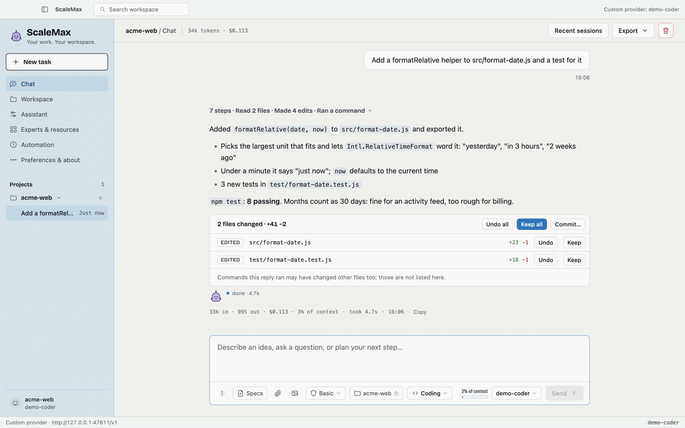
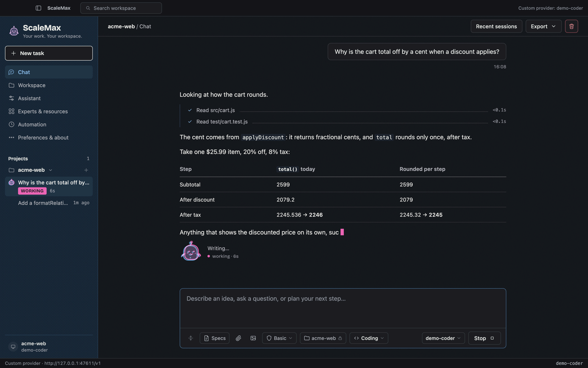
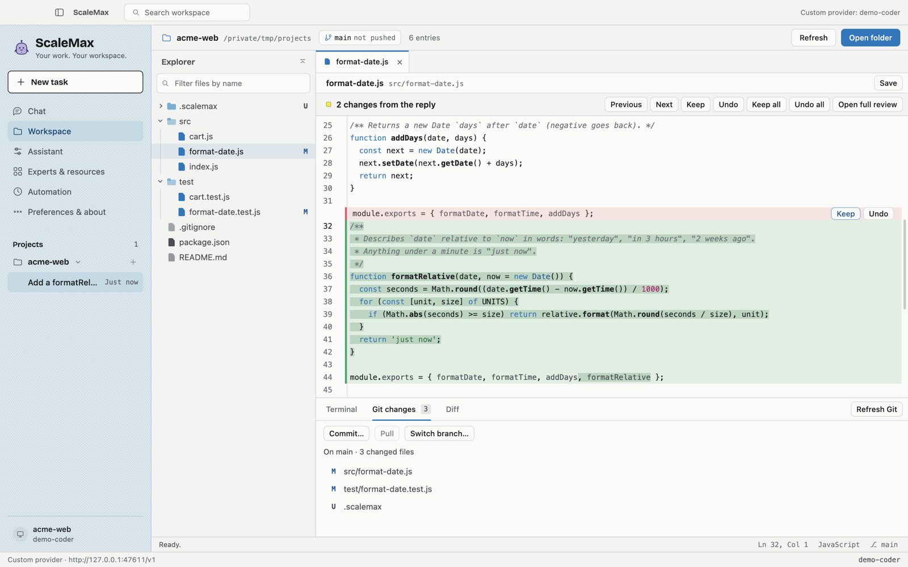
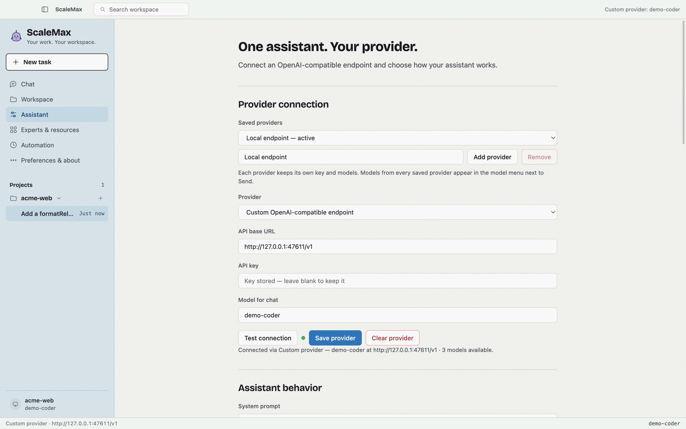
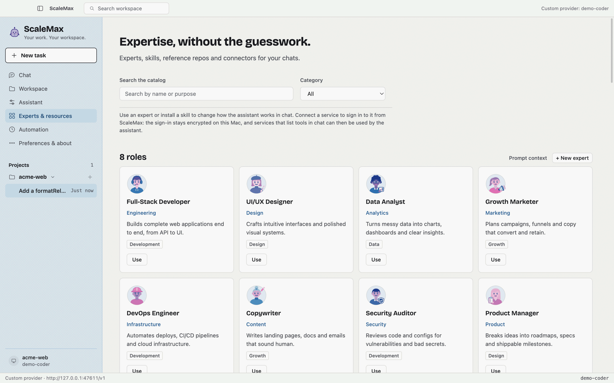
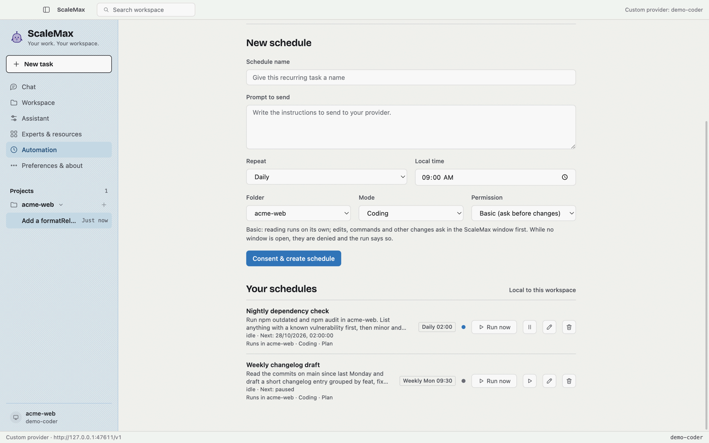

# ScaleMax IDE

ScaleMax IDE is a native macOS desktop IDE for AI-assisted software development. It pairs a chat-first task workspace with a tabbed code workspace, an assistant configurator with MCP tools, an Experts · Skills · Connectors catalog, a scheduled Automation manager, and a macOS-native frameless window. The app is built with Electron; the renderer is plain ES modules with no build step, so `src/` is the source of truth you edit directly. The one exception is the code editor: CodeMirror 6 ships as a single committed bundle, `src/vendor/codemirror.js`, generated by `node build/vendor-codemirror.cjs` (never edit it by hand).

## Screenshots

| Chat | Chat, dark | Workspace |
| --- | --- | --- |
|  |  |  |

| Assistant | Experts & resources | Automation |
| --- | --- | --- |
|  |  |  |

## Install the app

Download the newest `.dmg` from [Releases](https://github.com/Sagar3079/scalemax-ide/releases). ScaleMax IDE runs on Macs with Apple silicon (M1 or later).

1. Open the `.dmg` and drag **ScaleMax IDE** into Applications. It installs as `ScaleMax IDE.app`, so it sits next to ScaleMax Studio if you have that too.
2. Open ScaleMax IDE. The app is signed ad hoc rather than by a registered Apple developer, so the first time you open a new version macOS stops it:
   - **macOS 15 (Sequoia) and later:** macOS says it could not verify that ScaleMax IDE is free of malware. Click **Done**, open **System Settings → Privacy & Security**, scroll to the message about ScaleMax IDE and click **Open Anyway**, then confirm with your password or Touch ID. Right-click → Open no longer works on macOS 15.
   - **macOS 14 and earlier:** in Applications, Control-click ScaleMax IDE, choose **Open**, then **Open** again.
3. After an update, macOS may ask whether ScaleMax IDE may use **scalemax-ide Safe Storage** in your keychain. Click **Always Allow**: that is where ScaleMax IDE keeps your saved API keys encrypted. If you click Deny, it can't read the keys you saved and you have to enter them again.

If you prefer Terminal, this clears the download flag so the app opens without step 2:

```bash
xattr -dr com.apple.quarantine "/Applications/ScaleMax IDE.app"
```

Versions up to **1.0.0 beta 3** were not signed, and macOS may call them "damaged". Download a newer version, or run the command above with that version's name, `ScaleMax.app`.

ScaleMax IDE keeps its settings, tasks and encrypted keys in `~/Library/Application Support/scalemax-ide`.

## Features

- **API-key provider connection** — connect the ScaleMax endpoint (or any OpenAI-compatible endpoint) with an `sm_live_` key; the key is encrypted at rest with `safeStorage` and never crosses the renderer bridge
- **Real chat, streamed** — replies appear as they are written; every file the assistant reads or edits and every command it runs shows as a step (with the command's output while it runs), folded above the answer when it is done. Stop keeps what was written so far. Reloading or closing the window stops the replies it was showing and keeps what they had written, with a note so the assistant knows the window went away (a crashed window stops them too); automations keep running
- **Review and undo what a reply changed** — under every reply that changed files, a card lists them with their added and removed lines; open one to see the diff, then keep it or undo it (file by file, or all at once). Undo never overwrites work done since, and the assistant is told what you undid. A file the reply changed that is open in the editor shows each change inline with Keep / Undo (see Workspace below)
- **Commit, push and open a pull request** — **Commit…** on a reply's changes card, in the Git panel or in a worktree's header ticks the reply's files (secret-looking files are never ticked or sent), suggests a one-line conventional commit message from your provider, commits to the current branch or a new `scalemax/<name>` branch, runs your commit hooks unless you tick "Skip hooks", then pushes and opens a pull request through the GitHub CLI with a link to it. Git runs with your own identity, settings and credentials; these are your actions, never tools the assistant can call. The Workspace header shows the branch with commits ahead ↑ and behind ↓; the Git panel adds Pull (fast-forward only) and Switch branch (stashing your changes if you ask)
- **A worktree per task** — a new, empty task in a Git repository can work in its own checkout (`<app data>/worktrees/<repo>-<task>` on a `scalemax/<name>` branch), so its changes stay out of your main checkout until you merge them. Its header offers Show in Finder, Commit, Merge into the base branch (in your main checkout, which must be clean and on that branch; a conflicting merge is undone), Create PR and Remove (the branch is kept)
- **Rewind, fork and export conversations** — under any of your messages, **Rewind to here** puts that message back in the message box and can undo the later replies' file changes (newest first, never over newer edits, with a list of what stayed); **Fork from here** copies the conversation before that message into a new task in the same folder, with the message waiting in the message box. **Recent sessions** (⌘⇧O) searches your tasks, and **Export transcript** saves a task as Markdown
- **Subagents, like Claude Code's Task tool** — in Working and Coding mode the assistant can hand a self-contained piece of work to a subagent with its own fresh conversation. An "explore" subagent only reads; a "general" one can do what the reply can, under the same permission, approvals (labelled "Subagent: …") and sandbox. Up to three run side by side, each shows as a collapsible group in the reply with its own steps, its file changes land in the reply's changes card and its tokens in the reply's cost, and Stop ends them all
- **Slash commands** — type `/` at the start of a message for a command menu: `/clear`, `/compact`, `/cost`, `/help`, `/init`, `/mode working|coding`, `/model`, `/plan` and `/review [focus]` (a read-only review of the folder's uncommitted changes, run in Plan permission), plus your own commands written as Markdown files (see Customization)
- **Hooks, like Claude Code's** — run your own shell commands before or after a tool call, when you send a message, or when a reply ends: block a call, allow it without a prompt, add a note or extra context. A project's hooks run only after you allow exactly that set, and any change asks again; Preferences → Hooks switches each one on or off (see Customization)
- **Long-running commands without losing the reply** — the assistant can run a dev server, watcher or long build in the background, then read its output, type into it or stop it. A bar above the composer shows what is running; **Show** opens a jobs dialog with live output and controls. Background commands stay with their project, are stopped when ScaleMax quits and never need `&`
- **Tokens and cost you can see** — every reply shows the tokens it used and what it cost with your provider's published prices, and the chat header keeps a running total for the task. When a provider does not report usage or prices, ScaleMax says so instead of showing a made-up `$0.00`
- **Conversations that stay in context** — type `/compact` (or use Compact) to summarize older turns: your transcript stays exactly as it is, only what the model sees is shortened. If your model publishes a context limit, ScaleMax compacts automatically before a message would overflow it, and leaves your message in the box if it still would not fit. Preferences → Conversation turns the automatic behaviour off
- **Plan before anything changes** — set permissions to **Plan** and the assistant can only look: it reads and searches, then answers with a plan, and every tool that would change something is refused outright, so there is nothing to approve by accident. Your folder is untouched, notes included. When you agree, **Run this plan** puts your permission back where it was and the assistant carries the plan out
- **Write a feature down before you build it, like Kiro's specs** — the assistant keeps requirements, a design and a task list per feature as plain Markdown in your project (`.scalemax/specs/<feature>/`), one document at a time so you can correct each one before the next. The **Specs** chip in the composer shows how many tasks are still open; the dialog shows the three documents and lets you tick a task off yourself. Because they are ordinary project files, they show up in the reply's changes card and can be undone like any other edit
- **Nothing leaves without you knowing** — pages the assistant finds or you give it open on their own, but an address it puts together itself asks first ("Open an address on …?", with an option to allow that site for the rest of the reply), so a file or web page that tries to talk it into sending your data somewhere cannot do it quietly. Reading your clipboard always asks. A server's own "read-only" labels only count once you trust that server. Local addresses stay unreachable in every spelling
- **Sandboxed model commands** — on macOS, the assistant's foreground and background commands default to a Seatbelt sandbox: project/temp/cache writes only, credential and app-data reads blocked (shell histories, browser data and other AI tools' sign-ins too), no Git hook/config changes (in a task's worktree no commits either: use **Commit…**), no writing ScaleMax's hook settings, no clipboard, Docker or desktop control, and signals only to processes the command started itself. Preferences → Commands controls sandbox/network; turning network off still allows localhost. Leaving the sandbox, or typing into an already outside-sandbox command, always asks one at a time — including in Bypass. Your own Workspace terminal is never sandboxed
- **Keeps going, and sees what you show it** — a rate limit, an overloaded server or a dropped connection is tried again on its own, an answer cut off at the length limit is continued, and long tasks stay within the model's context. For multi-step work the assistant keeps a to-do list you can watch. Paste or drop a picture into the message box (for models that can read pictures), or type `@` to send a file from your folder along with your message — or `@folder/` for a two-level listing, `@https://…` for a web page (fetched with the same guards as the assistant's own page reading) and `@job:j2` for a background command's recent output
- **Several tasks at once** — start a task, switch to another one (in another folder too) and ask there while the first keeps working; the sidebar shows which tasks are working and which finished while you were away
- **Two modes that really differ** — **Working** researches on the web, works with your files and hands results back (it can put something on your clipboard or open a file you asked for; apps, programs and launchers are never opened, only shown in the Finder); **Coding** explores your project, makes focused changes and runs your tests before it reports. The pills above the message box and the mode chip both switch it
- **Every task lives in a folder, like Kiro** — a conversation starts once you choose a folder (any folder, the Desktop included), and after the first message the task stays in that folder. The sidebar lists your projects with their tasks and a **+** to start another task in the same folder; New task lets you pick a different one
- **Clean replies** — answers are formatted (headings, lists, tables, code blocks with a Copy button) instead of showing raw Markdown symbols
- **Works in your project folder, like Claude Code or Codex** — pick a folder from the folder menu (recent folders included; the last one opens again at start). The model can list, read, search, edit and write its files and run commands there (reads run on their own in Basic; changes and commands ask first unless you chose Bypass all). Each chat remembers its folder. Secret files such as `.env` and keys stay off limits
- **Project notes** — on the first message in a folder ScaleMax writes `.scalemax/SCALEMAX.md` (overview, stack, commands, structure) and reads it, plus any `AGENTS.md`, `CLAUDE.md` or Kiro steering files, into every chat there. Type `/init` to have ScaleMax rewrite the notes after reading the project; Preferences → Projects turns the automatic notes off
- **MCP tools, resources and prompts** — add Model Context Protocol servers (local stdio commands or remote Streamable HTTP endpoints); the model can call their tools during chat, under the same permission modes as the built-in tools, and each call is listed under the reply. It can also list and read a server's resources (a made-up address on a server you don't trust asks first), and a server's prompts can be filled in from its panel in the MCP view and inserted into the message box. Servers switched on for chat start in the background shortly after launch; one that is not ready within 5 seconds is left out of that reply with a note instead of holding it up
- **Composer controls** — pick the model next to Send, turn thinking on or off and set reasoning effort; tool permissions: Plan (read-only, propose first), Manual (ask every time), Basic (read-only tools run automatically) or Bypass all (autonomous, after your consent)
- **Image & video** — pick an image or video model in the model menu; its options (size, quality, aspect ratio, resolution, duration, edit, image-to-video) appear above the message box, results show in the chat with Download
- **Several providers** — save more than one provider; the model menu lists all of their models
- **Six views**, one click away in the sidebar:
  - **Chat** — the chat-first workspace with Working/Coding modes and starting-point chips
  - **Workspace** — an IDE layout: file tree with filter and Git decorations, a tabbed CodeMirror 6 editor, Terminal / Git changes / Diff panel with Commit, Pull and Switch branch, the branch with ahead/behind in the header, resizable panes. The editor highlights 22 languages and has multiple cursors (⌘D, Alt+click), find/replace (⌘F / ⌘⌥F), go to line (Ctrl+G), ⌘/ comments, folding, completion and auto-closing brackets; each tab keeps its own undo history, selection and scroll, and a file's line breaks (CRLF) and indentation are kept. When a reply changes a file you have open (with no unsaved edits), the tab shows each change against the earlier text with Keep / Undo per change and a bar to step through them (F7 / Shift+F7), keep or undo all, or open the full review
  - **Assistant** — provider connection, model catalog, system prompt, temperature, permissions and MCP servers (with each server's resources and prompts)
  - **Experts & resources** — animated expert characters, prompt templates, your own custom experts and skills, community references and 40 connectors (one-click sign-in for 14 of them, otherwise OAuth with your own app or an access token)
  - **Automation** — once, hourly, daily, weekly, monthly or every-N-minutes schedules with run now, pause/resume, edit and run history. Automations run on schedule while ScaleMax is running, also with its window closed (Preferences → Automations → "Run automations when the window is closed", on by default; when it is off, a run that comes due waits for a window and then runs once). A run that needs your approval while no window is open is refused at once and named under its reply
  - **Preferences & about** — theme, commands sandbox, automations, hooks, local data and app information
- **Search across tasks** with an overlay, plus a collapsible sidebar
- **Secure Electron renderer** — `contextIsolation: true`, no node integration; all filesystem and credential access goes through the preload bridge

## Prerequisites

- macOS 11 (Big Sur) or later
- Node.js 18 or later

## Installing from source

```bash
cd scalemax-ide
npm install
```

## Running

```bash
npm start
```

On macOS this starts a branded copy of the Electron runtime (`node_modules/.scalemax-dev/ScaleMax IDE.app`, created on first run in about a second), so the Dock and the menu bar show ScaleMax IDE and its icon instead of Electron.

### Electron runtime missing after installation

If npm reports `install scripts not yet covered by allowScripts`, it skipped Electron's `postinstall` download. The JavaScript package can exist while its desktop runtime and `path.txt` are missing. Do not delete the dependency tree or disable install-script protection globally.

The reviewed Electron version is already approved in this project's `package.json`. Run the verified repair from the project root in macOS Terminal:

```bash
npm run repair:electron --cache "$PWD/.cache/npm" && npm start --cache "$PWD/.cache/npm"
```

The repair runs Electron's own installer using the same Node runtime as npm. It preserves incomplete `dist` and `path.txt` entries under `.cache/electron-repair-backups/` before retrying into a clean destination. It never deletes `node_modules`, fakes a version file or marker, disables npm approvals, or changes host file protections. Downloads and extraction temporary files remain in `.cache/`. Electron's skip-download and distribution override options are ignored for the repair child only, without modifying your shell configuration.

`npm run check:electron` checks the required runtime files without changing anything. The same check runs automatically before `npm start`; a zero installer exit with missing runtime files is treated as a failure, not success. The check verifies installation files, not the full application UI or production security.

To run the repair with a specific Node 22 runtime, invoke it directly from the project root:

```bash
/path/to/node22/bin/node build/electron-runtime.cjs --repair && npm start --cache "$PWD/.cache/npm"
```

If repair fails, stop and inspect the installer output rather than repeatedly launching the app. File-protection refusals must be resolved in the execution environment; they are not bypassed by this script. Your preserved partial bundle remains in the printed backup path.

Approval is pinned to `electron@33.4.11`. After upgrading, review Electron's new installer and run `npm install-scripts approve electron` with an npm version supporting that command.

Dependency audit warnings are a separate issue. Do not use `npm audit fix --force` blindly: the audit proposes major upgrades to Electron and electron-builder, which need compatibility testing. This prototype is not ready for production distribution without dependency updates and real backend authentication/integrations.

## Browser preview (no Electron needed)

The renderer only talks to Electron through the `window.scalemaxAPI` bridge, so `src/web-shim.js` installs a faithful stand-in when the page is opened outside Electron. That means you can preview and click through the whole app in any browser — no `npm install`, no packaging.

```bash
python3 -m http.server 8765   # from the project root, so the fonts in assets/ load
# then open http://localhost:8765/src/index.html
```

In browser preview, tasks, settings and automations persist to `localStorage` instead of the Electron user-data file. Because a conversation needs a folder, the preview keeps a small demo folder (`demo-project`) in memory: **Open folder…** offers it, the Workspace view can browse and edit it (edits last until the tab is reloaded), and sending a message gets a labelled demo reply instead of a real one. Provider, connector, MCP, Git and real file access need the desktop app.

> The shim is a **no-op inside Electron** — if `preload.js` has already installed the real bridge, `web-shim.js` does nothing. It is safe to ship.

## Building a distributable

```bash
npm run build
```

The packaged application is written to `dist/`: `ScaleMax IDE.app`, plus `ScaleMax-IDE-<version>-arm64.dmg` and `ScaleMax-IDE-<version>-arm64-mac.zip`.

- **Version:** the `version` in `package.json` (for example `1.0.0-beta.4`) is the version shown in Finder, the About panel and Preferences, and the one in the file names. Raise it for every build you hand out.
- **Build number:** `npm run build` sets the bundle's build number (`CFBundleVersion`) to the number of commits on the checked-out branch. The About panel shows it after the version, so two builds of one version can still be told apart.
- **Signing:** `build/after-pack.cjs` signs the app ad hoc, so a downloaded copy can be allowed in Privacy & Security (see [Install the app](#install-the-app)). The app is not notarized. Distributing it without the warning needs an Apple Developer ID certificate and notarization.

## Authentication

ScaleMax is local-first: there is no sign-in screen and no account server. Access to a model provider is what unlocks the composer, and it is configured in the **Assistant** view.

1. Choose **ScaleMax (preconfigured)** and paste an `sm_live_…` key, or choose **Custom OpenAI-compatible endpoint** and enter its base URL plus key.
2. Press **Test connection** — the app verifies the key, discovers the model catalog and shows every model with an availability badge.
3. Pick a model for chat (every model the key can use is available), then **Save provider**.

Keys are encrypted at rest with Electron `safeStorage` when the OS keychain is available and kept only for the session otherwise. The renderer never receives the key — only a `hasKey` flag crosses the bridge. **Clear provider** removes the stored credential and settings.

## Project structure

```
scalemax-ide/
├── assets/               # icons and font files (shipped in the app)
├── build/                # Electron runtime check, smoke test, icon rendering, ad-hoc signing (after-pack.cjs)
│   └── vendor-codemirror.cjs # regenerates src/vendor/codemirror.js from pinned versions
├── dist/                 # build output (generated)
├── docs/screenshots/     # the screenshots in this README (not shipped in the app)
├── lib/
│   ├── provider.cjs      # OpenAI-compatible provider client (keys, models, chat, tool calls)
│   ├── subagents.cjs     # agent_task: subagents with their own tool loop inside a reply
│   ├── automations.cjs   # automations fired from the main process, also with the window closed
│   ├── git-flow.cjs      # commit, push, pull, switch branch, pull requests and task worktrees (user actions only)
│   ├── slash-commands.cjs # custom /commands from .scalemax/commands (and .claude/commands), /review
│   ├── hooks.cjs         # PreToolUse / PostToolUse / UserPromptSubmit / Stop hooks and their approvals
│   ├── connectors.cjs    # encrypted connector credentials, validation, OAuth sessions
│   ├── oauth.cjs         # loopback OAuth 2.0 engine (PKCE, token exchange, refresh)
│   ├── oauth-catalog.cjs # provider OAuth endpoints and rules (main process only)
│   ├── cli-auth.cjs      # GitHub sign-in through the GitHub CLI (downloads gh if missing)
│   ├── mcp.cjs           # MCP client: stdio + Streamable HTTP servers
│   ├── media.cjs         # image/video generation, polling, downloads (main process)
│   ├── mcp-oauth.cjs     # zero-setup MCP sign-in: discovery, dynamic client registration, PKCE
│   ├── mcp-directory.cjs # official MCP servers behind one-click connector sign-in
│   ├── tool-loop.cjs     # chat tool-calling loop, approvals and streamed steps
│   ├── metrics.cjs       # token usage and USD cost accounting for replies and compaction
│   ├── commands.cjs      # cross-platform shell, macOS terminal wrapper and cleaned output
│   ├── jobs.cjs          # main-level background commands: output, input, stop and process groups
│   ├── sandbox.cjs       # macOS Seatbelt policy for commands the model runs
│   ├── progress.cjs      # forwards a reply's progress to the window in 40 ms batches
│   ├── checkpoints.cjs   # what each reply changed: review, undo and keep
│   ├── line-diff.cjs     # line diffs for the review
│   ├── workspace-tools.cjs # built-in chat tools for the open folder
│   ├── modes.cjs         # what Working and Coding mean: tools, working agreement, rounds
│   ├── specs.cjs         # feature specs as project files: requirements, design, task list
│   ├── web-tools.cjs     # web search and reading a page (guarded fetches)
│   ├── computer-tools.cjs # clipboard, open in the default app, show in the Finder
│   ├── project-notes.cjs # .scalemax/SCALEMAX.md and the per-chat project context
│   ├── shell-path.cjs    # login-shell PATH for apps opened from the Finder
│   ├── state.cjs         # atomic, validated JSON state store
│   └── workspace.cjs     # project folder access: list, read, write, Git, commands
├── src/
│   ├── app.js            # renderer logic: views, tasks, chat, catalogs, automations
│   ├── workspace-ui.js   # Workspace tab: tabs, tree, splitters, inline review of a reply's edits
│   ├── editor.js         # CodeMirror 6 setup: languages, keys, per-tab state, review helpers
│   ├── vendor/           # codemirror.js (generated bundle, ~1 MB) + its licence notices
│   ├── gitflow-ui.js     # commit dialog, Git panel actions, branch switch, worktree header + gitflow.css
│   ├── sessions-ui.js    # rewind, fork, Recent sessions (⌘⇧O), export transcript
│   ├── sessions.mjs      # pure helpers for rewind/fork/export
│   ├── slash-ui.js       # the / command menu + slash.css
│   ├── hooks-ui.js       # Preferences → Hooks: list, allow, switch on/off
│   ├── scheduler.js      # the window's side of automations (main fires them)
│   ├── catalog-ui.js     # catalog filters, details, connectors and OAuth dialog
│   ├── custom-ui.js      # create/edit custom experts and skills
│   ├── mcp-ui.js         # MCP server management
│   ├── composer-ui.js    # composer model/reasoning menu, permission modes, tool approval prompts
│   ├── markdown.js       # replies as formatted text (DOM only, never HTML) + markdown.css
│   ├── reply-ui.js       # replies in progress (one per task), steps + reply.css
│   ├── changes-ui.js     # the changes card under a reply and the review dialog + changes.css
│   ├── jobs-ui.js        # background commands bar/dialog and command sandbox preferences + jobs.css
│   ├── specs-ui.js       # specs chip/dialog and the "Run this plan" card + specs.css
│   ├── media-ui.js       # image/video generation options, results in chat, download
│   ├── mcp-presets.js    # one-step MCP servers (sign-in, public URL, local)
│   ├── mcp-directory.js  # renderer mirror of the one-click directory (connector ids only)
│   ├── avatars.js        # animated expert characters (SVG)
│   ├── data.js           # experts, skills, community references, connectors
│   ├── index.html        # single-page shell with all six views
│   ├── sm-tokens.css     # design tokens (light + dark themes)
│   ├── styles.css        # component styles built on the tokens
│   ├── workspace.css     # Workspace IDE layout
│   └── web-shim.js       # browser preview stand-in with an in-memory demo folder (no-op under Electron)
├── test/                 # node --test unit suites
├── main.js               # Electron main process (project root)
├── preload.js            # exposes window.scalemaxAPI bridge (project root)
├── package.json
└── README.md
```

## Customization

- **Theme** — switch between the light and dark token sets in **Preferences & about**, or edit the custom properties in `src/sm-tokens.css`
- **Accent color** — edit `--sm-brand-primary` in `src/sm-tokens.css`; primary accents, badges and brand marks derive from it
- **Brand name** — update the `ScaleMax` strings in `src/index.html` (title bar, sidebar, headings), `APP_NAME` in `lib/app-branding.cjs` (menus and About panel), `NAME` in `build/dev-app.cjs` and the `productName` field in `package.json`
- **App icon** — edit the SVG sources in `assets/icons/` (`scalemax-icon.svg`, `scalemax-icon-small.svg` for 16/32 px, `scalemax-mark.svg` for the sidebar), run `npm run icons` to re-render `icon.png` and `icon.icns`, then `npm run build`
- **Catalog content** — edit the arrays in `src/data.js` (`skill-catalog.js` and `connector-catalog.js` hold the full libraries)
- **Your own slash commands** — put a Markdown file in `<project>/.scalemax/commands/` or `~/.scalemax/commands/` (`.claude/commands/` is read too); `review-api.md` becomes `/review-api`, and a subfolder becomes a namespace (`frontend/component.md` → `/frontend:component`). Optional front matter: `description`, `argument-hint`, `model`, `mode`, `allowed-tools` (only narrows the tools offered). `$ARGUMENTS` and `$1`…`$9` are filled in from what you type after the name, and `@path` attaches files. A project's command wins over one of yours with the same name, and the built-in commands win over both
- **Hooks** — in `.scalemax/settings.json` of the project or of your home folder:

  ```json
  {"hooks": {"PreToolUse": [{"matcher": "workspace_(write|edit)",
    "hooks": [{"type": "command", "command": "./check.sh", "timeout": 30}]}]}}
  ```

  Events: `PreToolUse` (block the call, or allow it without the prompt), `PostToolUse` (adds a note to the result), `UserPromptSubmit` (adds context or blocks the message) and `Stop`. A hook gets the event as JSON on stdin and runs in the project folder, outside the sandbox, with your login shell's PATH. Exit 2 blocks with stderr as the reason; or print JSON `{decision, reason, additionalContext}`. Each run shows as a step of the reply. Writing `.scalemax/settings.json` always asks you first, even in Bypass, and sandboxed commands cannot write it

## License

MIT. See [LICENSE](LICENSE).
